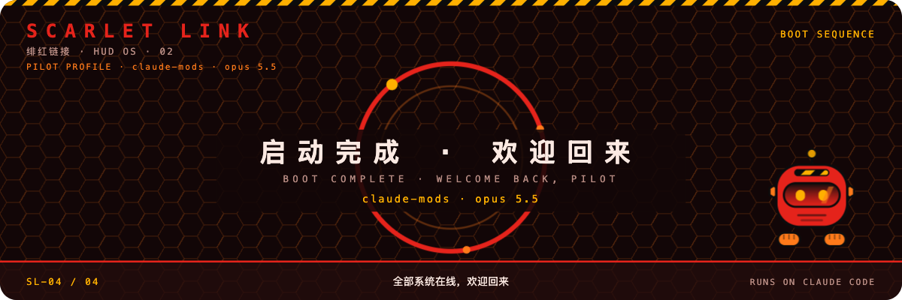
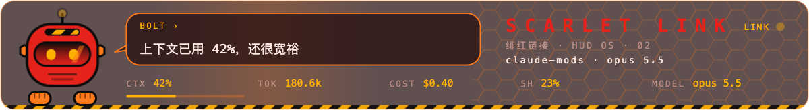
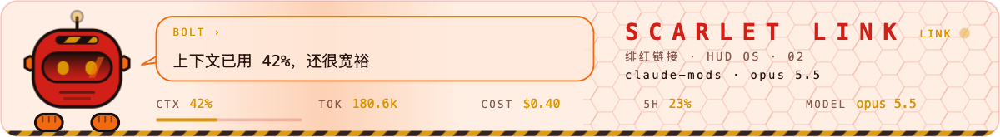

# claude-mods

Mods for Claude Code: plugins built on function hooks, TypeScript running inside Claude Code.

## Install

Paste this into Claude Code:

```text
Install claude-mods (https://github.com/Sma1lboy/claude-mods) for me:
1. Add a global alias so every `claude` starts with function hooks on: in my shell's startup file (~/.zshrc for zsh, ~/.bashrc for bash, ~/.config/fish/config.fish for fish), add
   alias claude='CLAUDE_CODE_ENABLE_FUNCTION_HOOKS=1 claude'
   If a `claude` alias is already there, add CLAUDE_CODE_ENABLE_FUNCTION_HOOKS=1 to it instead of adding a second one. If it already sets the variable, leave the file alone.
2. Run:
   claude plugin marketplace add sma1lboy/claude-mods
   claude plugin install usageline@claude-mods
3. Tell me which file you changed, and to open a new terminal and start claude again.
```

Or by hand, in a terminal, then restart Claude Code:

```sh
node -e 'const fs=require("fs"),f=require("os").homedir()+"/.claude/settings.json";const s=fs.existsSync(f)?JSON.parse(fs.readFileSync(f,"utf8")):{};s.env={...s.env,CLAUDE_CODE_ENABLE_FUNCTION_HOOKS:"1"};fs.writeFileSync(f,JSON.stringify(s,null,2)+"\n")'
claude plugin marketplace add sma1lboy/claude-mods
claude plugin install usageline@claude-mods
```

The first line sets `CLAUDE_CODE_ENABLE_FUNCTION_HOOKS=1` in `~/.claude/settings.json`; mods are early access and load only with it on. To update later:

```sh
claude plugin marketplace update claude-mods && claude plugin update usageline@claude-mods
```

## usageline

A status line drawn under the prompt by a mod, configured in [ccstatusline](https://github.com/sirmalloc/ccstatusline)'s own settings format, with its figures read from Claude Code instead of parsed out of the transcript.

```
mod | 𖠰 main | ⎇ main | Ctx: 181.1k | Out: 129.0 t/s | (+22,-9) | Cost: $0.51 | Cache: 🟢 4m | Cache Hit: 90.7% | Miss: idle 5m20s > 5m ttl, +181k rewritten
```

### Settings

`~/.config/usageline/settings.json` takes the same JSON as `~/.config/ccstatusline/settings.json`: `lines` of widgets, each with `type`, `color`, `backgroundColor`, `bold`, `rawValue`, plus `colorLevel` and `defaultSeparator`. Copy your ccstatusline file there to keep your layout. [`usageline/settings.example.json`](usageline/settings.example.json) is a ccstatusline layout with cost and cache appended. With no file, the layout in `settings.example.json` is drawn, so a fresh install needs no settings.

| Widget | Where the figure comes from |
| --- | --- |
| `model` | the model that answered the last turn |
| `context-length`, `context-percentage`, `context-bar` | `$.session.usage()`, the figures `/context` uses |
| `output-speed` | output tokens over the time from each response's first streamed chunk to its end |
| `session-cost` | `$.session.usage().cost`, the session's `/cost` total |
| `cache-timer` | time since the last turn ended, against the 5-minute TTL |
| `cache-hit-rate`, `cache-read`, `cache-write` | the last turn's token counts |
| `git-worktree`, `git-branch`, `git-changes` | git, refreshed after each turn and each Bash or edit tool call |
| `custom-text`, `custom-command` | as in ccstatusline; a command reruns every 30 seconds |
| `usageline-cache-miss` | why the last turn's first request rewrote the cache: `first turn`, `idle 5m20s > 5m ttl`, `model a→b`, `after compact`, `prefix changed` |
| `usageline-today` | what this project (its git root) has cost today, across every session |

Powerline, flex modes and ccstatusline's other widgets are not drawn yet; an unknown widget draws nothing.

`/usageline` prints the ledger: this project's last seven days, then every project today.

Cost is Claude Code's own estimate, the `/cost` figure; on a subscription it is what the tokens would cost at API prices, and through a gateway the real charge is the gateway's.

To run it from a checkout: `CLAUDE_CODE_ENABLE_FUNCTION_HOOKS=1 claude --plugin-dir usageline`.

### Limits

- The countdown assumes the 5-minute cache TTL; a 1-hour TTL is not read yet.
- The cache timer reads in whole minutes: on 2.1.280 every redraw of the line under the prompt flashes one frame, so it redraws only when its text changes.
- It records turns from when it is installed; older history is not imported.

## goal

Gives the model a tool, `mcp__goal__goal`, that runs Claude Code's own `/goal`. The model can then set a goal itself, the same as you typing `/goal <condition>`: after each turn a separate check decides whether the condition is met, and Claude keeps working until it is. `args` takes a condition, `clear`, or nothing for the status.

```sh
claude plugin install goal@claude-mods
```

A plugin can't run a slash command while a tool call holds the turn, so the tool queues the command and `/goal` runs when the turn ends. If you interrupt that turn, the queued command is dropped. So a `clear` from the model lands late: while a goal is active, the goal check keeps that turn going until the goal is met or the check gives up, and only then does the clear run. To stop a goal at once, type `/goal clear` yourself. Two calls in one turn: the later one wins. Calls from subagents are refused. Unlike the built-in `ProposeGoal`, the tool doesn't go through the approval dialog that the `modelProposedGoals` setting controls; installing it means the model can set a goal without asking. `/goal` itself needs a trusted workspace and hooks that aren't disabled.

To run it from a checkout: `CLAUDE_CODE_ENABLE_FUNCTION_HOOKS=1 claude --plugin-dir goal`.

## Development

```
npm install
npm run typecheck   # tsc over every mod
npm test            # claude plugin test, for each mod
```

`types/claude-code.d.ts` comes from `/plugin-types` in Claude Code and is not committed; regenerate it after an update.

## desktop-skin

SCARLET LINK, a cockpit HUD skin drawn through the mod API's render sites, on the Claude Code Desktop surface and the terminal. Red and orange with black and amber, hex grids, warning stripes, monospace step codes.

- **Boot ceremony**, the first time the band above the prompt draws: capsule docking → neural link → sync rate rising → boot complete, about 9 seconds. It can be skipped and plays once; `/skin boot` replays it. Under reduced motion it shows its last frame.
- **HUD band** after it: BOLT, an original helmet robot, peeks up with a speech bubble that reads out the session's real figures (context used, cost, 5-hour and 7-day limits, turns), quips when it has none, and a telemetry strip. A figure the engine does not give is drawn as `—`.
- **Spinner words** themed on the terminal; on the desktop only the bare `Working` is replaced, step descriptions stay.
- `/skin` opens the pane: BOLT large, appearance (auto, dark, light), replay, hide, stop motion. `/skin on|off|dark|light|auto|still|motion` sets them directly.

```sh
claude plugin install desktop-skin@claude-mods
```

The desktop drawing needs a Claude Desktop whose bundled Claude Code has function hooks; Desktop 1.24012.9 bundles 2.1.219, which does not. What the API can and cannot skin, and why there is no wallpaper or sidebar restyle, is in [desktop-skin/docs/capabilities.md](desktop-skin/docs/capabilities.md).

These images and `desktop-skin/docs/boot.mp4` are Chromium renders of the mod SVG, **not Claude Desktop captures**. Live Desktop rendering and uninstall/restore verification remain pending. Tested with Claude Code **2.1.284**; older function-hook APIs (including 2.1.271) are incompatible.




